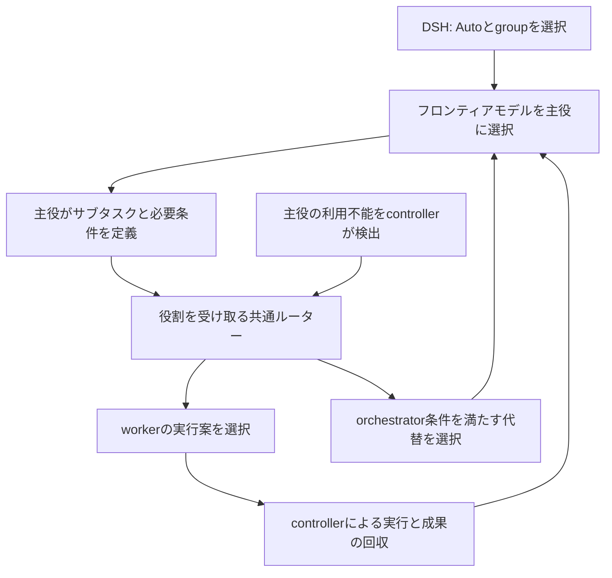

# DSH Autoのモデル登録とルーティング設計

調査日: 2026-11-06。状態: 一次資料と既存コードを確認した設計案。Autoの実装と比較実験は未実施。

所有者による運用の具体化: 通常の主役はフロンティアモデルのオーケストレーター。
サブタスクのworker選択と主役が利用不能になった場合の代替選択へ共通ルーターを使う。
役割と保存形式の契約は[ルーティング契約v1](harness-routing-contract-v1-2026-11-06.md)に定義する。
以下のtask分類と効率比較は役割条件を満たした候補内へ適用する。

## 推奨する構成

モデルの登録情報を使う決定的なselectorを先に作る。orchestratorとworkerの役割を要求に含める。
通常はオーケストレーターがworkerのtask条件を渡す。小型分類器は自由文しかない入口への補助とする。
モデル別promptは同じ管理画面から参照できるようにするが性能評価とは別の資産にする。
普段の入口はDSHのTUIとし既存のmodel pickerにAutoを追加する。



分類器が使えない場合は明示した保守的なルールに戻す。利用可能な候補がなければ待機理由を返す。
分類器も同じgroupと利用条件の対象とする。分類のために別providerへ情報を送る経路を暗黙に作らない。

## 一次資料から得たこと

| 調査対象 | 確認した内容 | このハーネスへの採用判断 |
| --- | --- | --- |
| [RouteLLM](https://github.com/lm-sys/RouteLLM) | preference dataから強弱2モデルを選ぶ。入力分布に合わせたthreshold調整を推奨 | 学習と評価の参考。現行モデル群とサブスク管理を直接置換しない |
| [vLLM Semantic RouterのMulti Factor](https://vllm-sr.ai/docs/tutorials/algorithm/selection/multi-factor/) | 候補の適格性と品質・速度・費用・負荷の比較を分離。重み付けと優先順の方式を提供 | 制約を先に確定する構成を採用。初期版は優先順で説明可能にする |
| [Session-Aware Agentic Routing](https://vllm.ai/blog/2026-06-02-session-aware-agentic-routing) | tool loopとprovider固有の継続状態を考慮。切り替え時のcache損失も扱う | タスク開始時に選び安全な区切りまで保持する |
| [RSI-Router](https://arxiv.org/html/2609.34712v1) | 小型モデルでsubtaskを識別し割り当てとmodel-specific skillを適用 | 作業分類と実績に基づく割り当てを参考にする。自己改変は初期版に含めない |
| [TwinRouterBench v5](https://arxiv.org/abs/2605.18859v5) | 静的なrouting評価と実際のagent実行評価を分ける | replayによる制約検査の後に完了率と実消費を比較する |

RSI-Routerは2026年9月のpreprint。DeepSeek-V4.1-FlashとQwen3.5-9Bの組み合わせを評価している。
同論文のablationでは小型モデルに次の段階の難易度だけを判断させる直接routingはstep単位のrandom baselineを下回った。
また専用skillを外した結果はtaskによって異なる。prompt追加が常に品質改善になるとは扱わない。
小型モデルの費用にはGPU計測から定めた価格比の仮定があり報告された節約率をこのサブスク環境へ移さない。
ここからの提案は「分類を補助させる＋割り当てを実測で検証する」であり同論文の方式を再現済みという意味ではない。

vLLMの文書は更新される。今回確認したAPIや設定例をそのまま依存versionの契約にしない。
既存routerを丸ごと導入してもDSHの認証・group・履歴・Core承認との接続は別途必要になる。

## 登録する情報

ユーザーには1枚のModel Cardとして見せる。内部では更新頻度と所有者が違う情報を分ける。

| 情報 | 内容 | 保管・更新 |
| --- | --- | --- |
| ModelSpec | 正確なmodel ID・revision・task分類のhint・出典・確認日 | version管理するcatalog |
| ExecutionProfile | model参照・instruction profile参照・effort・runtimeとadapterの版 | version管理する実行条件 |
| Connection | serving provider・wire model ID・対応機能・認証参照・group・課金枠参照 | 共有宣言とdeviceのprivate binding |
| Evaluation | task種別ごとの成功率・修正回数・所要時間・消費量・試験条件・件数 | 出典付き評価記録 |
| LiveState | 利用枠・reset時刻・観測時刻・予約済み容量・障害・待ち時間 | privateなruntime state |

タグは検索と候補提示に使う。`coding`や`design`が付いていること自体を品質や利用権限の証明にしない。
画像・tool calling・context容量は実際の接続経路で検証する。model vendorの宣伝値だけで有効化しない。
価格と速度はmodel固有とは限らない。同じmodelでもAPI・subscription・hosted endpoint・local環境で別の接続となる。

GLMをMistral経由で使う場合は次の関係になる。

| 対象 | 例 |
| --- | --- |
| model identity | GLM 5.3 |
| serving provider | Mistral |
| wire model ID | `zai-glm-5-3` |
| instruction候補 | `glm` profileの特定revision |
| usage/billing | 接続先のMistralアカウントに紐づく枠 |

モデル名から課金先やpromptを文字列の部分一致で推測しない。
同じsubscriptionを別モデルや別端末から使っても残量を別々の資産として二重計上しない。

### 数値評価の粒度

評価は少なくともmodel・effort・prompt版・runtime/adapter版・task種別を識別する。
skill集合やcontext量で条件が変わる場合はその条件も記録する。
単一の「総合性能90点」を全taskへ適用しない。異なるbenchmarkの点数を直接平均しない。

初期値は出典付きの適性区分と優先順に限定する。未計測値はnull相当のunknownとして扱う。
実測後は件数とばらつきが付いたtask別指標を追加する。数回成功しただけで成功率100%を一般化しない。
外部benchmark・operatorの仮説・この環境の実測を別の種類として保持する。

モデルを切り替えたtaskでは最後に使ったmodelだけへ成功を帰属させない。
難しいtaskばかり割り当てられたmodelを単純な生の成功率で不当に下位へ落とさない。

## 静的ルールと小型モデルの分担

| 方式 | 長所 | 制約 | 採用時期 |
| --- | --- | --- | --- |
| 明示したtask情報と静的ルール | 速く再現可能。新規モデルを追加しやすい | 自由文だけでは分類が曖昧になる | 初期版 |
| embeddingによる類似度 | 過去の似た仕事を探せる | 説明文の近さは成功率ではない。実績のない新modelには弱い | 評価データが集まってから検討 |
| 小型モデルによる分類 | 自由文の目的と作業段階を拾える | 推論費用と遅延と分類誤りが増える | ルールで決められない場合に限定 |
| 実績から学習したrouter | task別の結果を選択へ反映できる | データの偏りとmodel更新への追従が必要 | baselineとの比較後 |

小型モデルへ最初から全候補のmodel名と評判を渡して自由に選ばせない。
小型分類器を使う場合は目的と必要能力の抽出に限定し最終選択を決定的な関数で行う。
フロンティアモデルがworker条件を作成済みならその構造化された条件を使い再分類しない。

分類出力の概念例。実装済みschemaや実測結果ではない。

```json
{
  "task_kind": "code_change",
  "phase": "implementation",
  "scope_hint": "multiple_files",
  "required_modalities": ["text"],
  "tool_use": true,
  "ambiguity": "high",
  "unknown_fields": ["dependency_scope"]
}
```

taskは少数の大分類から始める。code理解・変更・原因調査・設計・文章処理・視覚操作などを候補とする。
task分類と必要な品質の下限は別に扱う。「文章処理なら必ず小型」とは決めない。
schema外の値は拒否する。分類器の自己申告confidenceを成功確率として使わない。
曖昧な場合は品質を優先する既定の選択へ戻す。classifier failureで制約を緩めない。

分類器は固定された接続で呼ぶ。Autoへ再帰的に投げない。
入力は目的・必要な直近の文脈・runtimeで観測した状態に限定する。
毎tool応答を再分類せずタスク開始や明確な区切りでのみ判定する。
tool呼び出し待ちや継続状態の互換性はruntimeが決める。LLMの分類結果で上書きしない。

## 選択の計算

最初から任意の重みの合計点にはしない。初期版は次の順に絞り込む。

1. 明示したgroup・account・model・実行先・課金条件を保持
2. 役割条件と接続可能性と必要機能とcontext容量と継続互換性を確認
3. 鮮度のある利用情報と同時実行の予約を確認
4. taskに必要な品質区分を満たす候補へ限定
5. subscription枠の余裕とresetまでの時間と今後の予約を比較
6. 比較可能な実績があれば完了までの消費量と待ち時間で選択
7. 同点なら明示した優先順と安定したID順で決定

候補を増減しただけで無関係な正規化値が変動する設計は初期版では避ける。
実績が揃った段階で必要品質を維持したまま費用と速度のtrade-offを調整する。

APIの金額とsubscriptionの残量割合は異なる単位で保持する。
subscriptionの追加支払いがゼロでも有限の枠を消費する。重いtask用の余力を残す。
reset直前の余剰枠は選択材料になるが枠を使い切ること自体を目的にしない。
同じ枠の同時利用を防ぐ予約は共有の管理層で行う。観測から次の観測までの消費を無視しない。

残量不明や古い観測を「余裕あり」として計算しない。
初期版の厳密なquota-aware候補には鮮度のある観測が必要。手動選択とAutoの候補条件は区別する。
Proでprogrammatic usage APIを使えないMistralは観測経路の検証が別途必要。
DSH内のtoken集計だけでアカウント全体の残量を計算済みとはしない。
根拠: [Mistral usage docs](https://docs.mistral.ai/admin/billing-usage/usage-limits)。

## DSHへの接続

画面上はAutoをmodel選択肢として出すが内部ではrequested modeとeffective routeを分ける。
実際のmodelを確定してから能力検査とprompt組み立てとrequestの記録を行う。
model変更で適用promptが変わる場合も版とdigestを記録する。全モデルのpromptを常時contextへ入れない。
過去のsystem messageや署名されたreasoningを新しいmodel向けに黙って書き換えない。

確認したDSH 0.2.1-rc.2の`LlmAdapter`はcatalog登録とprepared callを提供する。
`LlmRuntime.prepareCall`は選択経路とmetadataを束縛する。
`ConfigureCall`はeffortなどのcontrolsを調整できるが捕捉済みrouteを変更できない。
agent loopが組み立てたrequestも不変として扱う契約になっている。
したがってstream段階でmodel名だけを置換する実装にはしない。
TUIでAutoを維持しつつ具体的なrouteを事前確定するhook位置はprototypeで確認する必要がある。

tool loop中は同じmodelを保持する。単にidleになっただけで非互換な履歴を移動可能とは判断しない。
途中切り替えは次の段階で実装する。結果不明の外部操作を再送しない。
Core経由では現在の承認が具体的な実行planに紐づくため承認後のroute差し替えはできない。
初期版は具体的な選択をplan確定より前に行う。DSHとCore dispatchの接続も未完了として扱う。

## 既存資産との関係

[`agents/model-profiles/v1/registry.json`](../../agents/model-profiles/v1/registry.json)はprompt候補のcatalog。
現在のstatusはcandidateで全profileの`behavior_validation`が`not_run`。
確認期限は2026-11-02で今回の調査日時点では更新が必要。品質評価表としては使えない。
既存の[`model-profile.ts`](../../agents/scripts/model-profile.ts)はproviderとmodel IDの完全一致で選択する。
Mistral経由のGLM wire IDをZ.aiのprofileへ結ぶ処理は現在ない。

新しいrouting catalogから既存promptへ版付き参照を持つ。
既存compilerへ未知のmodelや別hosted providerを暗黙に許可する変更は行わない。
profile参照を明示するcompiler拡張と対応経路の試験を別途行う。
instructionsの変更でgroup・tool権限・budgetが変わることはない。

モデル追加は次の順にする。

1. 正確なmodel identityと接続経路と出典を登録
2. 対応機能と利用条件を観測して候補を検証
3. instruction profileとeffortの組み合わせを登録
4. task別の代表例で既存baselineと比較
5. 読み取り専用の選択previewで候補と除外理由を確認
6. 検証済みのtask分類に限ってAutoの候補へ昇格

model一覧や対応機能を取得できる接続では登録候補を自動生成する。
APIが返したcatalog情報と実際に動作確認した能力は区別する。適性や品質の点数は生成AIに捏造させない。
必要な手入力は利用可能なgroupと接続と方針を中心にする。性能表の維持は出典更新と評価処理で補助する。

新modelの追加だけで小型分類器を再学習する必要がない構成にする。
分類器はtask種別を出しcatalog側が割り当てるためmodel集合の更新と切り離せる。

## 評価と実装順

まずcatalogと純粋なselectorを実装する。入力snapshotとpolicy版が同じなら同じ結果を返す。
次にDSHに選択previewを接続し現状の固定モデル実行と比較する。
その後worker選択とorchestratorの初期選択へ接続する。主役の代替はcontrollerの復旧経路として実装する。
小型分類器は構造化したtask条件のない入口への補助として比較試験する。
subtask単位の切り替えや実績からの学習は継続状態と評価基盤の検証後に進める。

制約testではgroup越境・未対応tool・unknown quota・共有枠の競合・明示modelの変更・期限切れ観測を検出する。
DSHの統合testでは再開後のAuto設定保持とactual route記録とeffort整合性を確認する。
tool loop中の切り替えと結果不明時の再実行を拒否する。

品質比較は同じ入力snapshotのtaskで固定baseline・静的Auto・分類補助Autoを比較する。
少数の代表taskで配線を検証した後に別のholdout taskで改善を評価する。
学習と検証の分割はrepositoryやtask系列でも分けて類似taskの漏れを抑える。
観測ログだけでは選ばなかったmodelの結果は分からない。previewだけで節約や品質維持を証明しない。

測るのは受け入れ条件を満たした割合・修正回数・完了時間・総使用量・classifier自身の負担。
モデルの完了宣言を成功ラベルにしない。テスト結果と成果物の採用結果を使う。
設定やpromptの改善は版を付けて比較する。稼働中に検証なしでpolicyを書き換えない。

今回行ったのは一次資料の調査と設計の記録。新しい依存導入・課金設定変更・モデル推論・Autoの有効化は行っていない。
