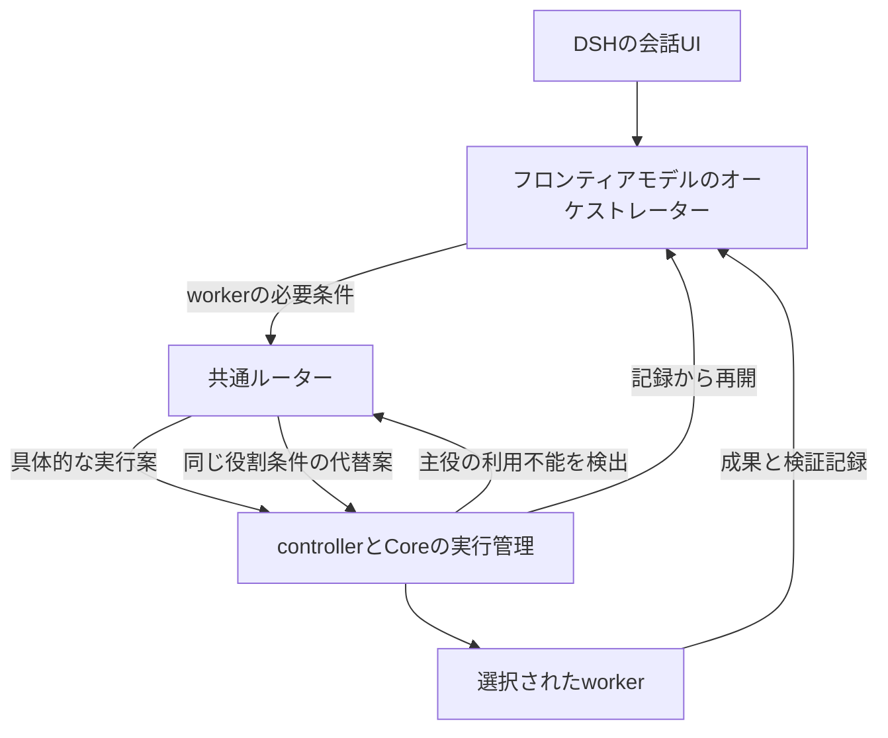

# オーケストレーターとworkerの共通ルーティング契約v1

状態: 所有者が示した運用フローに基づく保存形式とAPI契約の設計案。schema validatorと実行経路は未実装。
調査の根拠は[Auto routing設計](harness-auto-routing-design-2026-11-06.md)を参照する。

## 基本フローと責務

通常はフロンティアモデルが会話・計画・タスク分割・成果の統合を担う。
各サブタスクの必要条件を共通ルーターへ渡してworkerの実行先を選ぶ。
主役が利用不能になった場合はモデルの外で動くcontrollerが同じルーターへ代替を要求する。
DSHのAutoはこの方針を選ぶUIであり毎回最安モデルへ会話を振り分ける方針ではない。

| 所有者                   | 責務                                                            |
| ------------------------ | --------------------------------------------------------------- |
| オーケストレーターモデル | task分割・必要能力の提案・worker成果の統合                      |
| router                   | 許可範囲内の実行profileと接続先の選択・理由の返却               |
| controllerとCore         | 実行の許可と予約・起動と停止・利用不能の検出・引き継ぎ          |
| DSH adapterとUI          | model呼び出し・tool loop・会話表示・Autoの選択と実際のroute表示 |

routerはworkerを起動しない。選択結果は実行権限ではない。
モデルが動かなくても代替選択を開始できるようにcontrollerはモデルから独立して動作する。
通常のworker選択ではオーケストレーターが構造化したtask情報を渡すため毎回の小型分類器は不要。
小型分類器は自由文しかない外部アプリなどへの補助として同じ契約の手前に追加できる。

## 役割と選択方針

役割は`orchestrator`と`worker`の2つから始める。
reviewや調査や文章処理はworkerのtask分類として表現し役割enumを用途ごとに増やさない。
フロンティアという名称だけを能力検証に使わず役割profileに検証済み候補と品質下限を持つ。

| 役割         | 通常の選択                                           | 利用不能時                                           |
| ------------ | ---------------------------------------------------- | ---------------------------------------------------- |
| orchestrator | 統合判断と継続性を優先。会話中は保持                 | 同じ役割条件を満たす候補へ切り替え。候補なしなら待機 |
| worker       | taskごとの品質下限を満たす候補から消費量と速度を比較 | 同じtask条件で再選択。再実行可否はcontrollerが判断   |

役割profileにはcatalog内の適格候補と優先順と継続条件を保存する。
groupごとの許可範囲と予算はCore側policyへの参照で束縛する。
orchestratorの予約容量をworkerが使い切らないよう共有課金枠に役割別の余力を設ける。
初期値の余力は明示した運用値とし消費見積もりや使用量の実測から後で調整する。
固定modelを選んだsessionの代替方針とAutoを選んだsessionの代替方針は区別する。
権限・group・課金条件・必要品質を代替選択のために緩めない。

## v1の共通形式

交換形式はUTF-8 JSON。各文書に`schema_version: 1`と`kind`を必須とする。
宣言には安定した`id`と単調増加する`revision`を持たせる。
記録には一意の`id`とUTCの`created_at`を持たせる。
参照は`id`と`revision`と保存されたUTF-8本文のSHA-256 digestで固定する。
JSON整形を変える場合もdigestが変わる。既存Coreの署名形式やcanonicalizationは変更しない。
未知のschema versionと未知の実行制約は拒否する。移行は新しい文書を作り旧記録を保持する。
欠測値はnullと理由で表す。数量には単位と観測時刻を持たせる。

### 保存する文書

| kind                      | 主な必須情報                                                        | 所有・保管                       |
| ------------------------- | ------------------------------------------------------------------- | -------------------------------- |
| `ModelSpec`               | model identity・対応能力・出典・検証状態                            | 秘密を含まないcatalogをGit管理   |
| `ExecutionProfile`        | ModelSpec参照・prompt参照・effort・runtime/adapterの版・評価参照    | 秘密を含まないcatalogをGit管理   |
| `RolePolicy`              | role・適格profile・優先順・継続条件・policy参照                     | 正規のpolicy管理経路で版管理     |
| `ConnectionBinding`       | serving provider・wire ID・host・認証参照・課金枠参照               | deviceとoperatorのprivate設定    |
| `CapacitySnapshot`        | 課金枠ID・観測値と単位・source・観測時刻・失効時刻・予約参照        | privateなruntime state           |
| `EvaluationRecord`        | 実行条件参照・task分類・成果の判定根拠・測定値・件数                | 評価記録。公開可能な集計のみ分離 |
| `RouteRequest`            | 要求ID・role・trigger・task条件・policy参照・継続状態参照           | privateな実行記録                |
| `RouteDecision`           | 要求参照・選択結果・具体profileと接続・snapshot参照・理由・有効期限 | Coreの実行記録へ関連付け         |
| `OrchestrationCheckpoint` | 目的・判断記録・taskとworkerの参照・未処理事項・履歴と成果物の参照  | privateな既存checkpoint機構      |

これは論理的な文書形式の定義であり9種類のserviceやdatabaseを新設する指示ではない。
既存のTask・Attempt・Effect・budget・checkpointを参照する。競合する実行state machineは増やさない。
認証情報そのものと会話本文と個人アカウント情報を公開catalogへ保存しない。
実行時のroute記録と継続状態はprivateな保存領域としGit公開の対象と分ける。

### RouteRequest

| field                          | 契約                                                              |
| ------------------------------ | ----------------------------------------------------------------- |
| `request_id`                   | callerとworkspaceと操作の範囲で一意。同一IDの異なる内容はconflict |
| `role`                         | `orchestrator`または`worker`                                      |
| `trigger`                      | `initial`・`worker_assignment`・`failover`・`explicit_change`     |
| `task_ref` / `parent_task_ref` | 既存taskの参照。workerは親を記録                                  |
| `task_requirements`            | task分類・品質下限の提案・必要能力・context見積もり・期限         |
| `preferences`                  | 希望model・速度や消費の希望。強制条件とは区別                     |
| `policy_ref`                   | 解決済みの許可範囲とRolePolicyへの参照                            |
| `continuity_ref`               | checkpoint・前回route・現在の実行状態への参照                     |
| `failure_ref`                  | failover時の構造化された観測記録への参照                          |

callerとworkspaceの実体は認証済みの呼出経路から取得する。
modelが渡した`policy_ref`を権限の証明には使わない。taskから有効なpolicyを引いて照合する。
LLMが提案できる条件は継承したpolicyを狭める方向に限定する。
workerへ渡すのは必要な作業文脈。親の全会話を無条件に複製しない。

### RouteDecision

| field            | 契約                                                            |
| ---------------- | --------------------------------------------------------------- |
| `request_ref`    | 要求IDと内容digest                                              |
| `status`         | `selected`・`wait`・`unavailable`                               |
| `selection`      | selectedの場合のExecutionProfileとConnectionBindingの版付き参照 |
| `effective_role` | 選択に用いた役割                                                |
| `reason_codes`   | 機械可読の選択理由と候補除外理由                                |
| `evidence_refs`  | policy・catalog・評価・容量snapshot・継続状態への参照           |
| `expires_at`     | 選択情報を新規dispatchへ使える期限                              |
| `retry_at`       | wait時に観測根拠がある場合のみ提示                              |

同じ要求IDには記録済みの決定を返す。期限切れや実行不可になった決定を別modelへ書き換えない。
再評価は新しい要求IDと前の決定への参照を持たせる。
選択から実行までに残量やpolicyが変わり得るためdispatch直前に再検証と容量予約を行う。
routerのpure selectionと容量予約は分離する。競合時は新しいsnapshotで再計算する。
内部の判断理由と実際に使ったmodelはDSHに表示する。Autoという名前だけを履歴に残さない。

## オーケストレーターの代替と保存状態

controllerが構造化された利用上限・認証失効・障害を観測してfailoverを要求する。
一時的なrate limitとsubscription枯渇は区別する。短い待機で回復する場合の待機も選択肢とする。
ルーティング先には同じorchestratorの役割条件を要求する。

代替modelには次の状態を参照で渡す。

- ユーザーの目的と拘束条件
- 採用済みの計画と判断の根拠
- task構造と完了した成果物
- 稼働中workerのTask・Attempt・Effect参照
- 未回答の質問と未処理の検証結果
- 現在のgroupとpolicyと利用上限
- 元の会話記録と引き継ぎ要約の版

checkpointは観測可能な作業状態を保存する。モデルの内部思考の再現を前提にしない。
主役交代だけを理由に稼働中workerを再起動しない。既存のtaskへ再接続して結果を回収する。
provider固有のcontinuation IDや署名されたreasoningを別providerへそのまま移植しない。
別modelで再開する場合はadapterが検証したportableな文脈と作業状態を使う。

外部操作の結果が不明なら新しい主役にも未確定として渡す。再送の許可にはしない。
同時に2つの主役が新しい仕事を発行しないようcontrollerで発行世代を管理する。
古い主役の新規dispatchを拒否できない実行経路では停止確認まで交代を開始しない。
代替候補がない場合は待機を記録する。小型worker用modelへ主役を黙って降格しない。

## 現実の実装との差分

DSH側のAuto入力と選択結果の事前反映は未実装。
Core側のDSH dispatchとlive quotaと共有枠のleaseも未接続部分がある。
既存Coreは具体的な実行planに承認を束縛する。旧planの承認で新routeを起動しない。
自動代替には許可された役割・候補範囲・費用を表す契約と後続Attemptのadmission接続が必要。
この文書のpolicy参照を追加しただけではその権限は成立しない。

実装順は保存schemaとpure selector → worker選択preview → orchestrator初期選択 → 実行管理接続 → failover。
workerの自動起動を有効にすることと保存schemaを実装することは別工程とする。
このプロジェクトの将来の運用設計は現在のCodex sessionのsingle-agent制限を変更しない。

## 検証条件

- 同じsnapshotとpolicyと要求から同じ選択を再現できる
- workerとorchestratorの品質下限を混同しない
- 使用枠と予約が同じアカウントで二重計上されない
- 利用不能になった主役を呼び出さず代替選択が開始できる
- 主役交代後も稼働中workerが重複起動しない
- 古い発行世代の新規dispatchが拒否される
- 結果不明のEffectを代替側で再送しない
- groupと課金条件と明示固定を維持する
- schemaの未知versionと期限切れの決定を新規実行へ使わない

今回は設計文書の追加のみ。実行設定・モデル選択・委譲設定・認証・課金設定は変更していない。
